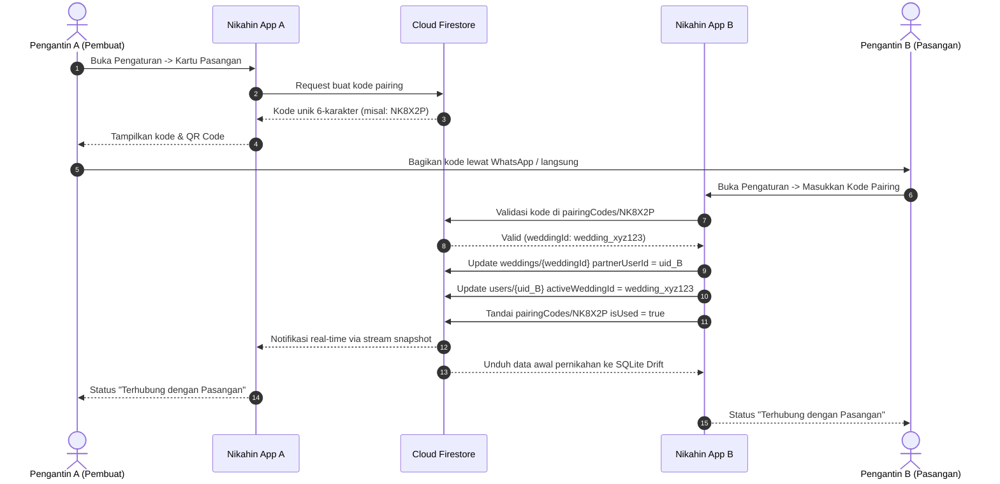

# Panduan Arsitektur Sinkronisasi Pasangan (Couple Sync & Pairing Code)

Dokumen ini mendokumentasikan sistem sinkronisasi rencana pernikahan antar pasangan calon pengantin (CPP & CPW) pada aplikasi Nikahin.

---

## 1. Konsep & Tujuan

Aplikasi Nikahin dirancang untuk digunakan bersama oleh dua orang calon pengantin. Daripada harus membagikan kata sandi akun, Nikahin menyediakan fitur **Couple Pairing** yang menghubungkan dua akun pengguna mandiri ke dalam satu wadah pernikahan (*Wedding*) yang sama.

Keuntungan:
- **Privasi**: Masing-masing pengguna tetap memiliki akun, email, dan autentikasi independen.
- **Kolaborasi Real-Time**: Perubahan anggaran, tamu, rundown, dan checklist oleh salah satu pasangan langsung tersinkronkan ke perangkat pasangan lainnya melalui Cloud Firestore.
- **Offline Persistence**: Masing-masing perangkat tetap menyimpan salinan data lokal di SQLite (Drift) sehingga aplikasi tetap dapat dibuka saat tidak ada koneksi internet.

---

## 2. Struktur Data Cloud Firestore

### A. Koleksi `weddings/{weddingId}`
Dokumen utama yang menyimpan rencana pernikahan bersama:
```json
{
  "creatorUserId": "uid_pengantin_pria",
  "partnerUserId": "uid_pengantin_wanita",
  "weddingDate": "2026-12-25T08:00:00.000Z",
  "groomName": "Rivaldi",
  "brideName": "Pasangan",
  "activePairingCode": "NK8X2P",
  "updatedAt": "2026-10-29T10:00:00.000Z"
}
```

### B. Sub-Koleksi di Bawah `weddings/{weddingId}/`
Semua entitas pernikahan disimpan di bawah dokumen pernikahan bersama:
- `expenses/`: Pos pengeluaran dan status pembayaran (Belum Bayar, DP, Lunas).
- `guests/`: Daftar tamu undangan, klasifikasi, dan RSVP.
- `rundown/`: Jadwal acara dan penanggung jawab (PIC).
- `committee/`: Susunan panitia keluarga dan distribusi seragam.
- `seserahan/`: Daftar hantaran dan seserahan.
- `documents/`: Berkas persyaratan KUA dan Catatan Sipil.

### C. Koleksi Indeks `pairingCodes/{code}`
Digunakan untuk pencarian cepat saat memasukkan kode pasangan tanpa perlu memindai seluruh dokumen pernikahan:
```json
{
  "weddingId": "wedding_xyz123",
  "creatorUserId": "uid_pengantin_pria",
  "createdAt": "2026-10-29T10:00:00.000Z",
  "expiresAt": "2026-11-05T10:00:00.000Z",
  "isUsed": false
}
```

---

## 3. Alur Kerja Pairing (Hubungkan Pasangan)



---

## 4. Alur Kerja Pemutusan Pasangan (Unlink Partner)

Jika terjadi kesalahan penghubungan atau pasangan ingin mengelola rencana terpisah, aplikasi menyediakan fitur **Putus Tautan (Unlink)** yang aman:

1. Pengguna membuka menu **Pengaturan** -> **Kartu Pasangan** -> ketuk tombol **Putuskan Hubungan**.
2. Muncul dialog konfirmasi peringatan bahwa akses rencana bersama akan dihentikan.
3. Fungsi `CoupleSyncService.unlinkPartner()` dieksekusi:
   - Menghapus referensi `partnerUserId` pada dokumen `weddings/{weddingId}`.
   - Mengembalikan `activeWeddingId` milik pasangan ke ID pribadinya sendiri.
   - Cache lokal di Drift SQLite tetap aman dan tidak korup.
4. Perubahan ini dilindungi oleh aturan keamanan `firestore.rules` agar hanya pengguna sah yang berhak memodifikasi dokumen pernikahan mereka.

---

## 5. Lokasi Berkas Kunci di Kode Sumber

- **Layanan Sinkronisasi**: `lib/data/services/couple_sync_service.dart`
- **State Notifier**: `lib/features/auth/presentation/auth_notifier.dart`
- **Komponen UI**:
  - `lib/features/settings/presentation/widgets/settings_partner_card.dart`
  - Dialog masukan kode: `lib/features/settings/presentation/widgets/pairing_code_dialog.dart`
- **Aturan Keamanan Cloud**: `firestore.rules`
